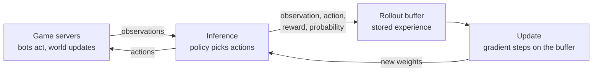

# Custom Learner: Design Options

Oct 18, 2026

The learner is the Python side of training. It picks actions for the bots, stores what happened, and turns that experience into a better policy. This document lays out the decisions a custom learner involves, the options for each, what the measurements so far say, and a recommendation. Nothing here is decided yet: it is the basis for discussion. Every technical term is explained where it first appears, and a glossary at the end collects them.

## Why a custom learner

From `docs/Throughput and Automation Plan.md`, all on this PC:

| Part | Measured steps per second |
| --- | --- |
| Game, 8 headless servers × 64 bots | ~35,000 |
| Stable-Baselines3 PPO, current network, any number of bots | ~4,000 |
| Plain PyTorch update, current network, 16-bit math | ~11,500 |
| Plain PyTorch update, cheaper first layer, 16-bit math | ~45,000 |

The game already produces experience about 9× faster than Stable-Baselines3 (SB3) can learn from it. SB3's own overhead is small: a plain PyTorch update of the same network in normal 32-bit math is only slightly faster. The gap comes from three things SB3 does not offer or does not do by default:

- **16-bit math**
- **keeping data on the GPU**
- **collecting new experience while the update runs**

The architecture plan also needs a memory (an LSTM), several action types at once, and one encoder shared between skills, all of which SB3 supports poorly or slowly. A custom learner is therefore worth building anyway.

## How training works, and where each decision sits

PPO (Proximal Policy Optimization, Schulman et al. 2017) is the algorithm the project uses. One training cycle:

1. **Collect.** The bots play for a while. Each step, the policy (the neural network) sees an observation and outputs a probability for each action; one action is sampled. The observation, the action, the probability the policy gave it, and the reward are stored. A batch of collected steps is a *rollout*; the storage is the *rollout buffer*.
2. **Update.** The learner computes how much better or worse each action turned out than expected. This is the *advantage*, computed with GAE (generalized advantage estimation): a weighted mix of short-term and long-term reward that trades noise against bias. It then nudges the network to make good actions more likely and bad ones less likely. It goes over the buffer several times, called *epochs*, in random chunks called *minibatches*. PPO's key trick is the *clip*: it refuses to change any action's probability by more than about 20% in one update, which keeps learning stable.
3. **Repeat** with the updated network.

PPO is *on-policy*: its math assumes the experience in the buffer was collected by the same network that is being updated. That assumption is behind decision 1.

## Decision 1: collect and update in turns, or at the same time

**What SB3 does (synchronous).** Collect a rollout, stop the game, update, resume. The servers sit idle during every update, so the time per step is the sum of both parts:

> throughput = 1 / (1 / game speed + 1 / update speed)

With the game at 35,000 and the update at 13,000 steps/s, that gives about 9,500. Even with a 45,000 update it gives only about 19,700.

**Overlapped (one update behind).** Collect the next rollout with the current weights while the update trains on the previous rollout. Throughput becomes the slower of the two parts instead of their sum: about 35,000 with a fast update. The cost is *policy lag*: the data being trained on was collected by weights one update old, so PPO's on-policy assumption is slightly wrong. PPO is fairly tolerant of this, because the clip already limits how far one update moves the policy.

**Fully asynchronous (APPO, IMPALA).** Workers collect continuously, and the learner updates whenever enough experience has arrived. Data can be several updates old. Two named designs:

- **IMPALA** (Importance Weighted Actor-Learner Architecture, DeepMind, Espeholt et al. 2018). The collectors ("actors") never wait for the learner. The learner corrects for stale data with *V-trace*, a form of importance weighting: each stored action is reweighted by how much more or less likely the current network is to take it than the old network that actually took it. This ratio is capped so that one strange sample cannot dominate.
- **APPO** (Asynchronous PPO, from Sample Factory, Petrenko et al. 2020). The same continuous pipeline, but with PPO's clipped update, optionally plus V-trace. Sample Factory reached very high throughput on a single machine this way.

**Recommendation: overlapped first.** It gets almost all of the speed of the asynchronous designs (the update just has to keep up with the game). The policy lag is small and fixed at exactly one update, and it needs no V-trace. We can measure whether the lag hurts by comparing learning curves with and without overlap on the same task. APPO with V-trace stays as an upgrade if we later run many more servers than one learner can keep up with, for example on the cluster.

## Decision 2: where the policy picks actions

Every decision, every bot needs an action from the network.

| Option | How | For | Against |
| --- | --- | --- | --- |
| A. GPU, in the learner process | Each server sends its bots' observations; the learner runs one forward pass for all of them and sends actions back | Large batches use the GPU well; one copy of the weights | A network round trip per decision |
| B. CPU, inside each game server | Export the network (e.g. ONNX) and run it in C# in the mod | No round trip | Weights must be shipped to every server after each update; CPU time taken from the game, which is the throughput we are protecting |
| C. CPU workers in Python | One inference process per server | Isolated | Same CPU cost as B, plus process overhead |

Measured: SB3 runs inference for 512 bots at 40,000–72,000 steps/s on the GPU, so A has headroom.

**Recommendation: A**, with one detail. Each server's batch is answered as soon as it arrives, without waiting for all servers ("no global lockstep"). A slow server then never holds up the others.

## Decision 3: how observations reach Python

Today the mod sends floats over local TCP. Per bot per decision that is a 40×40 grid of 4-byte floats (6.4 KB) plus 23 stats. At 35,000 decisions/s that is about 225 MB/s.

| Option | Change | Effect |
| --- | --- | --- |
| 1. Bytes for the grid | Grid cells take 3 values (air, platform, solid), or later about 10 small properties; send them as single bytes | 4× less data and less parsing, almost no code |
| 2. Shared memory | Both sides read and write one memory-mapped buffer; only a small "ready" signal goes over the socket | No copying through the network stack |

**Recommendation:** start with option 1, measure transport time in the profile, and move to option 2 only if transport shows up as a cost. Local TCP handles several GB/s, so after option 1 it is unlikely to matter.

## Decision 4: storage and the update on the GPU

These change speed, not what is learned.

- **Rollout buffer on the GPU.** Store observations on the GPU (grids as bytes), so the update never copies minibatches from main memory. With 512 bots × 512 steps that is about 420 MB of grids as bytes: it fits in the 3060's 12 GB.
- **16-bit math (bf16 mixed precision).** Most of the network's math runs in *bfloat16*, a 16-bit number format with the same range as normal 32-bit floats but less precision. The 3060 has dedicated units for 16-bit matrix math ("tensor cores"). The weights, the optimizer state and the loss stay in 32-bit, so the small precision loss does not accumulate. Measured: 2.0–2.6× faster updates on the current network.
- **channels_last.** A memory layout for images that stores the channels of each pixel next to each other, instead of whole channel planes one after another. Convolutions on tensor cores prefer it. Measured: +18–22% on top of bf16.
- **Larger minibatches.** Fewer, bigger gradient steps keep the GPU busy. Measured: 512 → 4096 gave +10–20% in 32-bit and more with bf16. The catch is learning, not speed: fewer gradient steps per epoch can slow learning, so the minibatch size and the number of epochs are tuned together on a real task.

## Decision 5: the network's first layer

The current encoder applies 32 filters of 3×3 at every one of the 1,600 grid cells before shrinking the grid. Most of the network's compute is in the first layers at full resolution:

| Encoder | Layers (grid size after each) | Multiply-adds per sample | Update speed (bf16, batch 4096) |
| --- | --- | --- | --- |
| Current | 3×3 stride 1 (40×40) → stride 2 (20×20) → stride 2 (10×10) → dense 256 | ~13 million | ~11,500/s |
| Stride 2 from the start | 3×3 stride 2 (20×20) → stride 2 (10×10) → stride 2 (5×5) → dense 256 | ~3.3 million | ~45,000/s |

The risk is detail. With stride 2 from the start, each first-layer output covers a 3×3 patch, but the patches overlap by only one tile, so the network sees a grid at half resolution from the first layer on. Navigation depends on one-tile features (a one-tile gap, a platform, a single block to jump over). The 32 filters can still encode "there is a gap in this patch", but whether learning suffers has to be measured, not argued.

Other shapes in between: full resolution with 16 filters instead of 32 (about half the cost), or cutting the grid into 2×2 patches first (similar to stride 2).

**Recommendation:** decide by a learning test, not a speed test. Train the current encoder and the stride-2 encoder on the same navigation task with the same seeds. Compare success rate against steps (does it learn as well per sample?) and against wall-clock time (does the speed make up for any loss?). The full architecture adds an entity list with attention, an inventory, a capability vector and an LSTM, and those cost compute too, so this test should be repeated once that encoder exists.

## Decision 6: memory (LSTM) and frame stacking

A plain network sees only the current observation. Navigation can partly do without memory (the target direction is in the stats), but later skills need it: what was seen a moment ago, which way the bot was going, what it already tried.

- **Frame stacking** gives the network the last few observations at once. It is cheap and simple, but it is memory only as far back as the stack.
- **An LSTM** (a recurrent layer that carries a hidden state from step to step) can remember for much longer. For training it needs three things:
  - the hidden state stored in the rollout buffer
  - minibatches made of short sequences (for example 32–64 steps) instead of single steps, with the gradient flowing through the sequence ("truncated backpropagation through time")
  - the state reset when an episode ends

  This is the part SB3 does poorly (`RecurrentPPO` is slow).

**Recommendation:** build the buffer for sequences from the start, but train Navigate first without an LSTM, adding it when a skill needs it. Retrofitting sequence support into a buffer later is the expensive path.

## Decision 7: several actions at once

Today an action is one of 8 combinations of left, right and jump. The architecture plan's skills need, at the same time:

- movement keys
- jump
- grapple
- an aim cell (15×15 = 225 options)
- use item
- a hotbar slot

One list of every combination would have millions of entries.

**Factorized action heads.** The network gets one output layer ("head") per action type, each a separate probability distribution. An action is one choice from each head, and its probability is the product of the heads' probabilities (in practice, the sum of their log-probabilities). PPO works unchanged on that total.

**Action masking.** Heads or options that do not apply get probability zero: aiming when nothing is held, a hotbar slot that is empty. The policy never wastes samples on them.

**Recommendation:** support any number of heads with masking in v1, even though Navigate uses only movement and jump.

## Decision 8: skills sharing one encoder

The architecture plan trains Navigate first, then reuses its encoder for Mine, Combat and Boss fights, with separate heads. Whether sharing helps is an ablation (an experiment that removes one part to see what it was worth). For the learner this only means modular code:

- the encoder, the heads and the value estimate are separate modules
- weights can be loaded and frozen per module

**Recommendation:** design for it, build nothing extra for v1.

## Proposed v1

| Part | Choice |
| --- | --- |
| Algorithm | PPO with clip, GAE, value loss, entropy bonus; behaviour kept identical to SB3's where possible |
| Collection | Overlapped: next rollout during the update, policy lag of exactly one update |
| Inference | GPU, in the learner process, each server's batch answered as it arrives |
| Transport | Local TCP, grids as bytes |
| Buffer | On the GPU, grids as bytes, sequence-ready layout |
| Update | bf16 mixed precision, channels_last, minibatch size and epochs tuned |
| Network | Encoder decided by the learning test (current vs stride 2) |
| Actions | Factorized heads with masking |
| Memory | Not in the first Navigate runs; the buffer supports it |

## How we check it

1. **Correctness before speed.** A custom PPO with a subtle bug can still learn, just worse, and that is hard to notice. So the first runs reproduce SB3 on the current navigation task: same network, same hyperparameters, same seeds, synchronous and 32-bit. The learning curves must match within seed-to-seed noise. Only then do the speedups go in, one at a time, each compared against the previous curve. "The 37 Implementation Details of PPO" (Huang et al., ICLR Blog Track 2022) lists the details that make PPO implementations differ, and CleanRL (Huang et al. 2022) is a short, readable single-file PPO to check against.
2. **Throughput target:** at least 25,000 steps/s end to end with 8 servers, measured as learned-from steps, not produced steps.
3. **Lag check:** overlapped against synchronous on the same task. Same final success within noise, or the overlap is dropped.

## Open questions for our discussion

1. Is a policy lag of one update acceptable to you, or should v1 be fully synchronous for simplicity and add overlap after?
2. Is Navigate's observation staying as it is for the learner's first version (40×40 grid with 3 values + 23 stats), or does the richer observation from the architecture plan (about 10 grid channels, entities, inventory, capabilities) come first? It changes the encoder and the speed numbers.
3. How much should the learner be reusable across skills from day one (decision 8), against getting Navigate trained soon?
4. Cluster: if training moves there later, many servers per learner would favour APPO with V-trace. Plan for that now, or only on the PC?

## Glossary

| Term | Meaning |
| --- | --- |
| Policy | The neural network that maps an observation to action probabilities |
| PPO | Proximal Policy Optimization: collect experience, then improve the policy in small, clipped steps |
| On-policy / off-policy | On-policy algorithms (PPO) assume the training data came from the current policy; off-policy ones can learn from data collected by other or older policies |
| Rollout, rollout buffer | A batch of collected steps, and the storage holding it |
| Epoch, minibatch | One pass over the whole buffer; one random chunk of it used for one gradient step |
| Advantage, GAE | How much better an action turned out than expected; GAE is the usual way to estimate it, mixing short- and long-term returns |
| Clip | PPO's limit on how much one update may change an action's probability (about ±20%) |
| Value function | A second output that predicts future reward from a state; used to compute advantages |
| Entropy bonus | A small reward for keeping action probabilities spread out, so the policy keeps exploring |
| Actor, learner | Actors collect experience (here: the game servers plus inference); the learner updates the network |
| Synchronous / asynchronous | Collect and update in turns, or both at the same time |
| Policy lag | How many updates old the network that collected a piece of data is |
| Importance weighting, V-trace | Reweighting old data by how likely the current policy is to take the same action; V-trace caps those weights to keep training stable |
| IMPALA | An asynchronous actor-learner design (DeepMind 2018) that corrects stale data with V-trace |
| APPO | Asynchronous PPO, from Sample Factory (2020): PPO's update in a continuous, asynchronous pipeline |
| bf16 (bfloat16) | A 16-bit floating point format with the range of 32-bit floats and less precision |
| Mixed precision | Doing most math in 16-bit while keeping weights and loss in 32-bit |
| Tensor cores | GPU units built for fast 16-bit matrix math |
| channels_last | A memory layout for images that tensor-core convolutions prefer |
| Stride | How many cells a convolution filter moves per step; stride 2 halves the grid size |
| Multiply-adds | The basic operation count of a network; a rough measure of compute per sample |
| LSTM | A recurrent layer that carries a hidden state between steps, giving the network memory |
| Truncated backpropagation through time | Training a recurrent network on short sequences, passing gradients back only within each sequence |
| Factorized action heads | One output distribution per action type; an action is one choice from each |
| Action masking | Setting impossible actions to probability zero |
| Ablation | An experiment that removes one component to measure what it contributes |

## References

- Schulman et al. 2017, [Proximal Policy Optimization Algorithms](https://arxiv.org/abs/1707.06347)
- Espeholt et al. 2018, [IMPALA: Scalable Distributed Deep-RL with Importance Weighted Actor-Learner Architectures](https://arxiv.org/abs/1802.01561)
- Petrenko et al. 2020, [Sample Factory: Egocentric 3D Control from Pixels at 100000 FPS with Asynchronous Reinforcement Learning](https://arxiv.org/abs/2006.11751)
- Huang et al. 2022, [The 37 Implementation Details of Proximal Policy Optimization](https://iclr-blog-track.github.io/2022/03/25/ppo-implementation-details/), ICLR Blog Track
- Huang et al. 2022, [CleanRL: High-quality Single-file Implementations of Deep Reinforcement Learning Algorithms](https://arxiv.org/abs/2111.08819)
