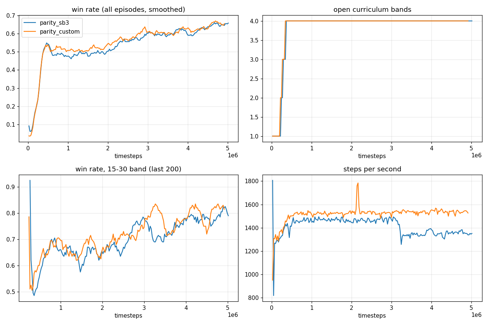

# Overnight Log

Oct 18–19, 2026. Decisions taken while you were away, why, and the results. Newest entries at the bottom of each section.

## Decisions

| # | Decision | Why | Easy to change? |
| --- | --- | --- | --- |
| 1 | Action output as in `docs/Action Design.md`: three heads (horizontal left/none/right, vertical up/none/down, jump), one decision every 4 ticks, no hook yet | The recommendations of that document; you had not answered yet | Yes: the heads are separate in both the mod and the learner |
| 2 | Scenarios generated automatically from the planner's path search (`Common/Scenarios/ScenarioGenerator.cs`), not from the 11 hand-placed zones | The zones are all in one personal world (`aTestingSP2`) and too few | — |
| 3 | Jump limit for the planner: 13 tiles | Measured in game: 6.13 tiles for a single jump, 13.12 with the bots' Tsunami in a Bottle (the old setting of 14 was an estimate) | Yes, an argument |
| 4 | 6 training worlds (`train_01`–`train_06`, seeds 101–106) and 2 held-out evaluation worlds (`eval_01`, `eval_02`, seeds 901–902), all small | Evaluation on terrain never trained on measures generalization, the old setup's main weakness | Yes |
| 5 | 1,200 scenarios per world: 400 per layer (surface, underground, cavern), 100 per distance band (5–15, 15–30, 30–60, 60–120 path tiles) | Even coverage for a curriculum ordered by path distance | Yes |

| 6 | The planner (`PathDistanceField`) now limits sideways movement through air: only within 5 tiles of ground the bot could jump from (gaps up to about 11 tiles can be crossed); all scenario sets regenerated with it | Your remark: some pairs looked unreachable. The old model let the bot walk across the open sky. The same model gives the training reward, so the reward no longer favours impossible routes either | Yes, the `max_air_gap` argument |
| 7 | Scenarios no policy ever solves are tracked (`scenario_stats.json` per run) rather than guaranteed reachable in advance | A full guarantee needs real movement physics, not a grid model; scenarios never solved across runs can be dropped | — |
| 8 | Navigate runs without enemies: servers start with `npc_spawns=0`, and enemies are cleared when the learner connects. Random tile updates are off (the movement profile) | Navigate should learn movement, not survival; the entity slots stay empty, as decided | Yes, a launch argument |
| 9 | Episode time limit: 40 + 4 × path distance decisions | A bot covers about 0.75 tiles per decision at walking speed, so this is generous without letting bots wander for minutes | Yes |
| 10 | Reward as before: +20 win, −5 death, −1 timeout, +0.5 per tile of path progress (at most 3 tiles per decision); timeouts are bootstrapped (not treated as real ends) | Keeps results comparable with the old setup | Yes |
| 11 | Curriculum: bands open one at a time when the hardest open band reaches 50% success over 200 episodes; half the episodes from the hardest open band, half from all open bands | Simple and transparent; adaptive sampling (Prioritized Level Replay) can come later | Yes |
| 12 | PPO settings for all runs unless noted: 128 steps per rollout per bot, minibatch 4096, 4 epochs, learning rate 2.5e-4, γ 0.99, entropy 0.01; 6 servers × 32 bots = 192 bots | Middle-of-the-road settings for this rollout size; the same for SB3 and the custom PPO | Yes |
| 13 | The custom PPO replaces SB3 for all further runs | It matched SB3's learning curve on the parity test (Results 1) and is faster | — |
| 14 | Planner: the player's body is 2 tiles wide, and it can drop through platforms; all scenario sets regenerated | Both followed from reading the game (`Player.width = 20`) and the action set (Results 2) | Yes |
| 15 | Experiment runs: 5M steps each, all with bf16 and overlapped collection, compared against a reference run with the same speed options (`fast_fovea_exposed`); one seed each | The night fits about six runs; one seed is enough to spot large differences, not small ones | Yes, `Training/navigate/overnight_queue.sh` |
| 16 | Held-out evaluation samples actions instead of taking the most likely one | The most likely action gets stuck: 49% vs 68% for the same policy (Results 3) | Yes, `--deterministic` |
| 17 | The goal input carries the route waypoint (12 path tiles ahead) besides the final target | Implements the agreed "planner sets the route"; the target alone misleads on long cave routes (Results 4) | Yes, `-obs waypoint=0` |

## Measurements

- **Environment speed with bots spread over real scenarios:** about 13 ms per step for 32 bots on one server (about 2,500 steps/s per server). That is roughly twice the benchmark's per-bot cost.
  - The benchmark kept all bots near the spawn point.
  - Spread over the world, every bot reads different memory: cache misses in both the game update and the observation.
  - Inside a step, the observations take 3.4 ms (32 bots) and the distance fields almost nothing.
- **Scripted baseline:** walk toward the target, jump when stuck or when the target is above. 71% success on the 5–15 band, enough to unlock the 15–30 band. A learned policy should beat this.

## Results

### 1. Parity: custom PPO vs Stable-Baselines3 (same environment, network and settings, 5M steps each)

| | SB3 | Custom |
| --- | --- | --- |
| Win rate per band at 4.9M steps (5–15 / 15–30 / 30–60 / 60–120) | 87 / 82 / 72 / 54% | 88 / 82 / 73 / 59% |
| All four bands open after | ~350k steps | ~350k steps |
| Throughput | 1,340–1,480 steps/s | 1,525 steps/s |
| Wall-clock for 5M steps | 59 min | 54 min |

**Verdict: the custom PPO learns the same as SB3.** The curves lie on top of each other from start to finish, so it replaces SB3 from here on. Both use fp32 and no overlap here; the speed options are tested next.

Where the time goes in the custom run: per iteration (24,576 steps), the update takes 11.4 s and the collection 4.8 s. **The learner, not the game, is the bottleneck**: the 6 servers would deliver about 5,100 steps/s if the learner kept up.

### 2. Scenarios no policy solved (from SB3's `scenario_stats.json`)

Scenarios tried at least 4 times and never solved, by band: 5–15: 102 of 1,010; 15–30: 42 of 278; 30–60: 63 of 264; 60–120: 532 of 1,745. Caverns dominate (for 60–120 cavern, 235 of 575).

Checks:
- **Is the target a real standing spot?** A bot placed on each never-solved target of `train_01` (142 scenarios) and left for 90 ticks drifts more than 1.5 tiles in only 11 cases, against 3 for solved targets. Mostly yes.
- **Is the planner's movement model right?** Reading it against the game showed two mismatches:
  - It treated the player as 1 tile wide; in the game it is 20 px (`Player.width = 20`), so the body always covers 2 columns and one-tile shafts and notches are impossible. Fixed: a cell is passable only if it and a neighbouring column are clear for 3 rows (same in `Standable`).
  - It forbade dropping through platforms, written when bots had no "down" key; the action set has one now. Fixed.

After the parity runs, all 8 scenario sets were regenerated with the corrected planner, and all runs after this point train on the new sets.

### 3. Held-out evaluation: sample actions, don't take the most likely one

Held-out worlds `eval_01` and `eval_02`, 512 fixed scenarios (64 per band per world), old scenario lists:

| Policy | Overall | 5–15 | 15–30 | 30–60 | 60–120 |
| --- | --- | --- | --- | --- | --- |
| Custom, most likely action | 49% | 73% | 59% | 42% | 23% |
| SB3, most likely action | 52% | 75% | 59% | 44% | 28% |
| **Custom, sampled actions** | **68%** | **80%** | **73%** | **72%** | **46%** |
| SB3, sampled actions | 70% | 84% | 77% | 71% | 47% |
| Scripted: walk toward the target, jump when stuck | 50% | 77% | 59% | 41% | 22% |
| Random | 1% | 2% | 0% | 0% | 1% |
| Custom, most likely action, on 2 training worlds | 51% | 80% | 47% | 49% | 27% |

- **No generalization gap:** with sampled actions the policy succeeds on unseen worlds as often as during training (68%).
- **Taking the most likely action gets the bot stuck**: it repeats the same failing move against a wall forever, where sampling eventually tries something else. It does as badly on the training worlds, so this is not overfitting.
- Decision 16: evaluation samples actions by default (`--deterministic` for the other mode).

### 4. The goal input carried only the final target, not the route waypoint

`docs/Observation Design.md` records "Navigate learns local movement. The planner sets the route, and the goal input carries the next waypoint", but the implementation only gave the final target. On a 60–120 tile cave route the straight line to the target often points into rock.

Decision 17, implemented: the planner's distance field now stores, per cell, the next step toward the target. Each decision the environment walks 12 steps along it from the bot's feet, and the observation gets 5 more goal numbers: `has_waypoint`, the clipped offset and the direction to that waypoint. `-obs waypoint=0` turns it off. That switch is used for the `no_waypoint` run, which measures what the waypoint is worth. A matching scripted baseline walks toward the waypoint instead of the target (`--policy greedy_wp`).

The old parity models cannot run on the new observation (11 goal numbers instead of 6), so their results stay on the old lists. The baselines are re-evaluated on the new lists.
